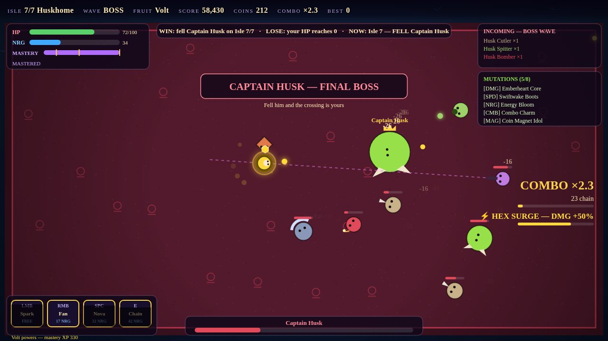
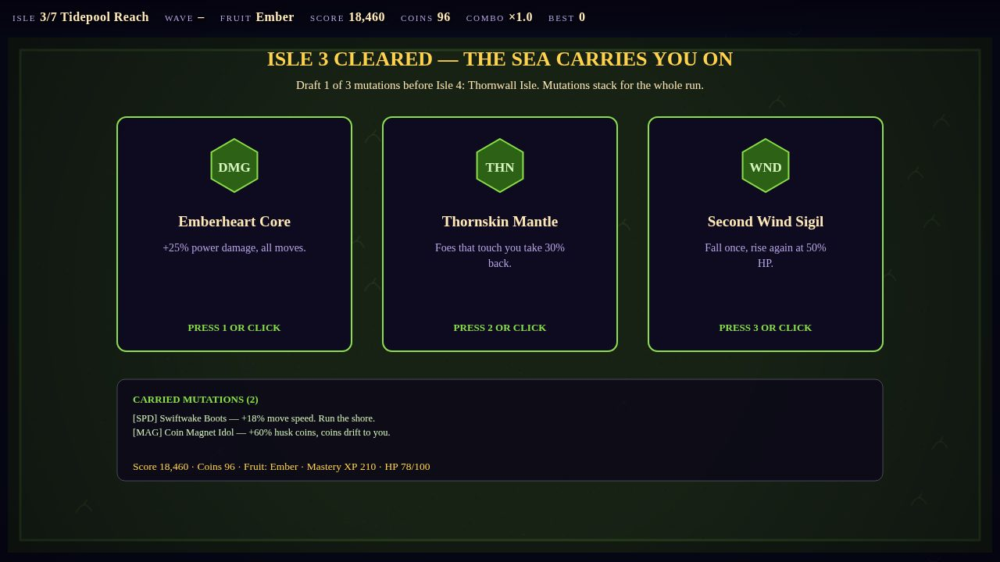
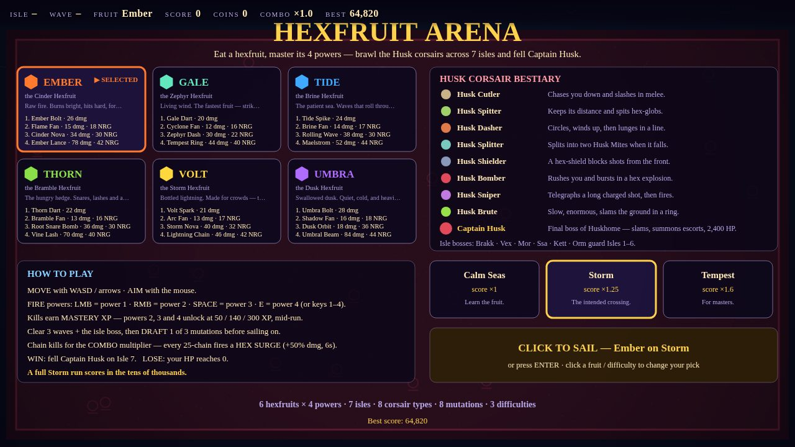

<!-- SPDX-License-Identifier: MIT -->
# HEXFRUIT ARENA

**HEXFRUIT ARENA — eat a hexfruit, master its 4 powers: 6 fruits, 7 isles, 8 corsairs, boss Captain Husk**





A top-down 2D arena brawler in a single HTML page (canvas + ES modules, no
build step, no network). Eat **one of 6 hexfruits** — Ember, Gale, Tide,
Thorn, Volt, Umbra — each with a **unique 4-move power set**, then brawl
waves of **Husk corsairs** across **7 isles**. Kills earn mastery XP that
unlocks powers 2, 3 and 4 mid-run; every isle ends in a boss; between isles
you **draft 1 of 3 mutations** (8 in the pool, all with real effects); the
crossing ends on Huskhome against **Captain Husk**. Three difficulties —
Calm Seas, Storm, Tempest — and a full run scores in the tens of thousands.

## How to play

- **Move** WASD / arrows · **Aim** mouse
- **Powers:** LMB = 1 · RMB = 2 · SPACE = 3 · E = 4 (or number keys 1–4)
- Clear 3 waves + the isle boss → draft a mutation → sail to the next isle
- **WIN:** fell Captain Husk on Isle 7 · **LOSE:** your HP reaches 0

The 8 corsair types all behave differently: Cutlers chase, Spitters keep
range, Dashers lunge, Splitters split into Mites, Shielders block frontal
shots, Bombers rush and burst, Snipers telegraph charged shots, Brutes
slam the ground in rings.

## Run it

```sh
node serve.ts          # http://localhost:8080
```

Deterministic screenshot scenes (used for the dossier):
`?shot=boss&seed=11`, `?shot=draft&seed=11`, `?shot=title&seed=11`,
`?shot=end&seed=11`.

Hand-in program (make.fun): `MAKEFUN_OUTPUT_DIR=out node main.ts` writes
`dossier.json` plus `game/` and `screenshots/` into the output directory.

All fruits, powers, corsairs and isles are invented for this game.
Licensed under the MIT License — see [LICENSE](LICENSE).
